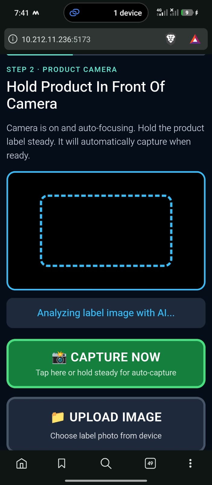
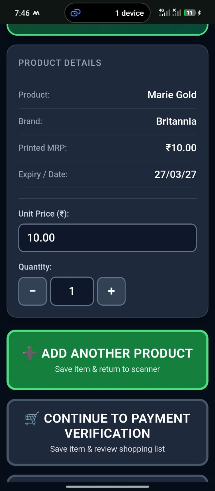
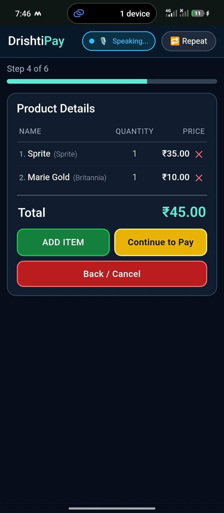
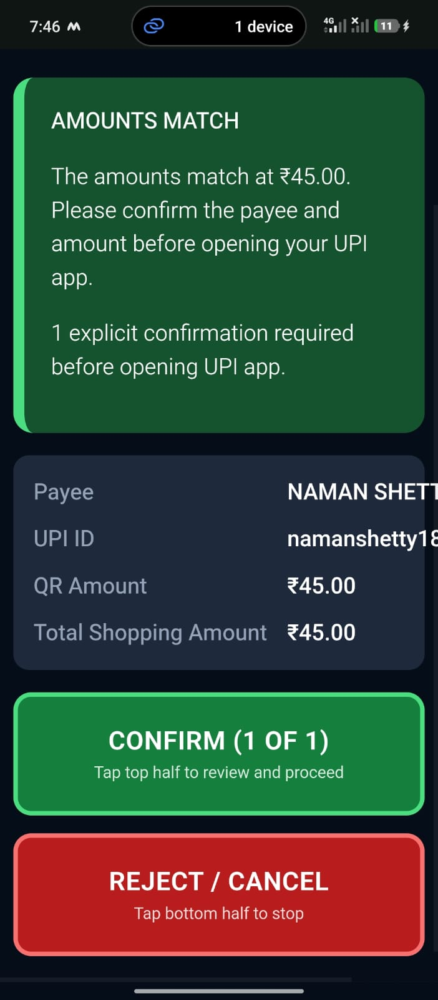

# DrishtiPay

**A voice-first payment amount verification tool for blind and low-vision shoppers in India.**

DrishtiPay helps users scan product labels, build a shopping list, compare its total with the amount in a merchant's UPI QR code, and hear the result before proceeding to payment.

## Features

- **Voice guidance:** Spoken feedback throughout the workflow.
- **Product scanning:** Read prices from camera images or uploads using Google Gemini, or enter them manually.
- **Shopping list:** Add multiple products, edit quantities and prices, and calculate totals accurately in paise.
- **UPI QR comparison:** Identify amount mismatches and QR codes without an embedded amount.
- **Mobile-friendly UI:** Designed for small screens.
- **Demo mode:** Try supported demo functionality without a Gemini API key.

## Workflow

1. **Scan a product:** Capture the product label with the camera or upload an image.

   

2. **Review product details:** Check the detected product name, brand, price, and quantity. Edit the details if needed.

   

3. **Build the shopping list:** Add products and review the quantities, unit prices, and total.

   

4. **Compare and confirm:** Scan the merchant's UPI QR code, listen to the amount comparison, and explicitly confirm before opening the UPI app.

   

## Installation

**Requirements:** Node.js 18+, Python 3.10+, and Git.

```bash
git clone https://github.com/shamanth-nayak/DrishtiPay.git
cd DrishtiPay
npm install
pip install -r backend/requirements.txt
```

Optional: create or edit `backend/.env`:

```env
GEMINI_API_KEY=your_gemini_api_key_here
CORS_ORIGINS=http://localhost:5173,http://127.0.0.1:5173
```

## Run the Application

**Windows:** Double-click `run_app.bat`.

Or start the services manually in separate terminals.

```bash
node server.mjs
```

```bash
python -m uvicorn backend.app:app --host 127.0.0.1 --port 8000
```

Open `http://localhost:5173` in your browser. Mobile camera access may require HTTPS or another secure context.

## Testing

```bash
npm test
python -m unittest backend/test_verification.py
```

The project reports 28 passing automated tests.

## Tech Stack

- **Frontend:** React, TypeScript, Vite
- **Backend:** Python, FastAPI
- **Server:** Node.js
- **AI:** Google Gemini API
- **Computer vision:** OpenCV
- **QR scanning:** ZXing
- **Accessibility:** Browser speech synthesis

## Security and Limitations

- DrishtiPay does not process payments or handle UPI PINs.
- It compares amounts but does not verify merchants or detect fraud.
- Users can review and edit scanned product details.
- Users must explicitly confirm before the UPI app opens.

## Future Improvements

More languages, improved voice commands, broader device testing, and usability testing with blind and low-vision users.
